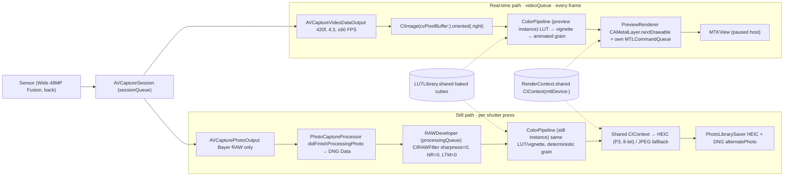

# AGENTS.md — ProCam

Operating manual for AI agents (and humans) working on this codebase. **Read it fully before
changing any file.** If a change conflicts with a rule here, stop and ask the user.

---

## 1. Mission

ProCam is a minimalist iOS 17+ camera for the iPhone 17 (base model). It **bypasses Apple's
computational photography** (Smart HDR, Deep Fusion, multi-frame fusion, over-sharpening, local tone
mapping). It captures a **single-frame Bayer RAW**, develops it with `CIRAWFilter` with sharpening and
noise reduction set to zero, and applies a film-style look. A **60 FPS Metal viewfinder** shows that
same look live, so what the user sees matches what they get.

## 2. Repository Layout

```
ProCam.xcodeproj/              Hand-written project (objectVersion 77, file-system-synchronized group)
ProCam/
├── App/ProCamApp.swift        @main entry; warms RenderContext + LUTLibrary off-main
├── Camera/
│   ├── CameraManager.swift    AVCaptureSession owner, queues, format selection, capture, events
│   └── PhotoCaptureProcessor.swift  Per-shot AVCapturePhotoCaptureDelegate (RAW extraction)
├── Rendering/
│   ├── RenderContext.swift    Shared MTLDevice + shared CIContext + color spaces
│   └── MetalPreviewView.swift PreviewRenderer (pushes frames into MTKView) + UIViewRepresentable
├── Color/
│   ├── ColorPreset.swift      ColorPreset enum + LookRecipe definitions (THE look catalogue)
│   ├── ColorPipeline.swift    LUTLibrary + ColorPipeline (LUT → vignette → grain), used by both paths
│   └── LUTBuilder.swift       ToneCurve, LookRecipe, LUTBuilder (bakes 33³ cubes), .cube parser
├── Develop/
│   ├── RAWDeveloper.swift     CIRAWFilter development + HEIC/JPEG encode + thumbnail
│   └── PhotoLibrarySaver.swift PHPhotoLibrary add-only save (HEIC + optional DNG alternate)
├── UI/
│   ├── CameraViewModel.swift  @MainActor @Observable state; consumes CameraManager.events
│   └── CameraView.swift       SwiftUI screen + controls (shutter, preset pills, thumbnail)
└── Assets.xcassets
```

Files placed under `ProCam/` are picked up by the target automatically, because the project uses a synchronized folder.
**Do not** add `PBXBuildFile` entries by hand.

## 3. System Architecture & Data Flow



### Queues & ownership

| Queue | QoS | Owns / runs | Never do here |
|---|---|---|---|
| `main` (`@MainActor`) | — | SwiftUI, `CameraViewModel`, `PreviewRenderer.attach/detach` | Session mutations, Core Image renders |
| `sessionQueue` (serial) | userInitiated | All `AVCaptureSession`/`AVCaptureDevice` mutation, `capturePhoto` | Pixel processing |
| `videoQueue` (serial) | userInteractive | `captureOutput(_:didOutput:from:)`, preview `ColorPipeline`, `PreviewRenderer.render` | Blocking waits, allocations of filters/contexts, main hops |
| `processingQueue` (serial) | userInitiated | `RAWDeveloper` (+ its own `ColorPipeline`) | Touching preview objects |
| AVFoundation internal | — | `PhotoCaptureProcessor` callbacks (serial per delegate) | Heavy work: hand off to `processingQueue` |

Events flow back to the UI through `CameraManager.events` (`AsyncStream<CameraEvent>`), which
`CameraViewModel` consumes on the main actor.

### Why preview == still

1. **Same graph:** both paths call `ColorPipeline.apply(_:to:grainSeed:)`.
2. **Same LUT bytes:** both read from `LUTLibrary.shared`.
3. **Same color space:** the LUT runs in gamma-encoded Display P3. The viewfinder layer and the HEIC are both P3.
4. **Same geometry:** 4:3 video format, stabilization off, geometric distortion correction off (device), lens correction off (`CIRAWFilter`).
5. **Same grain scale:** grain size is proportional to `extent.width / 1440`.
6. **Known, accepted delta:** the viewfinder base comes from Apple's video ISP tone mapping, and the still base comes from `CIRAWFilter`'s default RAW rendering (`boostAmount` = 1). They are close but not identical. Do not "fix" this by enabling processing on the still path.

## 4. Rules & Guardrails (MUST follow)

### 4.1 Computational photography — never re-enable
- ❌ Never add a processed companion format (`AVCapturePhotoSettings(rawPixelFormatType:processedFormat:)`) as the *developed* output. It triggers Smart HDR / Deep Fusion.
- ❌ Never set `isAppleProRAWEnabled = true` or select a ProRAW pixel format. ProRAW is multi-frame and computational.
- ❌ Never set `photoOutput.isVirtualDeviceConstituentPhotoDeliveryEnabled = true` or switch to a virtual device (`.builtInDualWideCamera`, etc.) for capture.
- ❌ Never enable `isVideoHDREnabled`, low-light boost, `isContentAwareDistortionCorrectionEnabled`, Live Photo, depth, portrait matte, or auto-deferred delivery.
- ❌ Never set `CIRAWFilter.sharpnessAmount`, `luminanceNoiseReductionAmount`, `detailAmount` or `localToneMapAmount` above 0 by default. `colorNoiseReductionAmount` may go up to about 0.1, and only as a user-facing option.
- ✅ RAW format selection must keep `AVCapturePhotoOutput.isBayerRAWPixelFormat` as the first preference.

### 4.2 Viewfinder performance (60 FPS budget = 16.6 ms)
- ❌ No allocation of `CIFilter`, `CIContext`, `CGColorSpace`, `MTLTexture`, `MTLCommandQueue`, LUT `Data`, `CIVector` or `DateFormatter` inside `captureOutput` or `PreviewRenderer.render`. Create them once in `init`. (`CIImage` wrappers and value types are fine.)
- ❌ No `DispatchQueue.main.sync`, no `await`, no blocking semaphore wait on `videoQueue`. Frames are **dropped**, never queued (`alwaysDiscardsLateVideoFrames = true`, `wait(timeout: .now())`).
- ❌ Do not replace the paused `MTKView` push model with a display-link pull model. Do not reintroduce `AVCaptureVideoPreviewLayer`.
- ❌ Do not put still rendering on the preview's `MTLCommandQueue`. Do not create the shared `CIContext` from a command queue: the preview must never wait behind a RAW develop.
- ✅ Keep `.cacheIntermediates: false` on the shared context.
- ✅ Per-frame filter chains should stay at ≤ 4 CI stages. Profile any addition (see §7).

### 4.3 Concurrency & memory
- `CIFilter` instances are **not thread-safe**. Give each queue its own `ColorPipeline`, and never share one across queues.
- All `AVCaptureSession`/`AVCaptureDevice` mutation happens on `sessionQueue` (enforced by `dispatchPrecondition` in configuration).
- Delegates and closures capture `[weak self]`. `PhotoCaptureProcessor` is retained in `CaptureBook.delegates` and **must** be removed in `captureDidFinish`.
- `CameraManager.maxCapturesInFlight` (2) bounds RAW memory. Do not raise it without Instruments → Allocations evidence on device.
- Wrap RAW development in `autoreleasepool`.
- Mark new types that cross queues as `@unchecked Sendable` **only** if a lock or queue confinement is documented in the type.

### 4.4 Coding standards
- Swift 5 language mode, iOS 17.0 deployment target. Do not use iOS 18+ APIs without `if #available` (e.g. `UTType.dng` is iOS 18; use `UTType.dngIdentifier`).
- SwiftUI state: `@Observable` + `@MainActor` view models. No `ObservableObject`/Combine for new code.
- Each file has one responsibility and keeps its `// MARK:` sections. Use doc comments (`///`) on every type and every non-trivial method.
- Errors surface as `CameraError` (a `LocalizedError`) and reach the UI through `CameraEvent.error` or `.captureFailed`. Never use `fatalError` except for impossible platform states (no Metal device).
- Log with `os.Logger` (subsystem `com.procam`). No `print`.
- Preserve existing comments and docstrings that are unrelated to your change.

## 5. Core Interfaces

### `CameraManager` (`Camera/CameraManager.swift`)
| Member | Notes |
|---|---|
| `static requestCameraAccess() async -> Bool` | Wraps `AVCaptureDevice` authorization. |
| `prepareAndStart() async throws` | One-time session configuration and start. Picks a 60 FPS 4:3 format that still offers Bayer RAW, falling back to `.photo` (30 FPS). |
| `start()` / `stop()` | Lifecycle, driven by `scenePhase`. |
| `preset: ColorPreset` | Thread-safe (`OSAllocatedUnfairLock`). Read every frame and frozen per capture. |
| `capturePhoto()` | Non-blocking. Admission is controlled by `maxCapturesInFlight`. |
| `focusAndExpose(at:)` | Device-space point; subject-area change resets to continuous. |
| `previewRenderer: PreviewRenderer` | Hand it to `MetalPreviewView`. |
| `events: AsyncStream<CameraEvent>` | `configured`, `captureBegan`, `shutterFired`, `captureSaved`, `captureFailed`, interruptions, errors. |

### `PreviewRenderer` / `MetalPreviewView` (`Rendering/MetalPreviewView.swift`)
- `attach(to:)` / `detach(from:)` (main actor): configures the `MTKView` (paused, `bgra8Unorm`, P3 layer, `framebufferOnly = false`).
- `render(_:)` (video queue): aspect-fills into the drawable, renders it with the shared `CIContext` and presents it. At most 3 frames are in flight.
- `devicePoint(forViewPoint:viewSize:)`: maps a tap to a point of interest, accounting for the aspect-fill crop.

### `ColorPipeline` / `LUTLibrary` (`Color/ColorPipeline.swift`)
- `ColorPipeline.apply(_ preset:, to:, grainSeed:) -> CIImage`. Pass a `grainSeed` for animated preview grain and `nil` for stills.
- `LUTLibrary.shared.cube(for:) -> ColorCube`. Cubes are immutable and baked once.

### `RAWDeveloper` (`Develop/RAWDeveloper.swift`)
- `develop(_ RAWCapture) throws -> DevelopedPhoto` (HEIC by default, JPEG fallback, ImageIO thumbnail).
- Tunables live in `DevelopSettings`.

### `PhotoLibrarySaver` (`Develop/PhotoLibrarySaver.swift`)
- `requestAuthorizationIfNeeded()` uses `.addOnly`.
- `save(_:originalDNG:)` writes HEIC as `.photo`, plus the DNG as `.alternatePhoto` when `keepsOriginalDNG` is set.

### `CameraViewModel` (`UI/CameraViewModel.swift`)
- `phase`, `selectedPreset` (forwards to `CameraManager.preset`), `processingCount`, `lastThumbnail`, `canCapture`, `banner`, plus the `shutterTrigger`/`savedTrigger`/`focusTrigger` counters for haptics and animation.

## 6. Adding New Presets / LUTs

### Option A — procedural recipe (preferred: no assets, tweakable in code)
1. In `Color/ColorPreset.swift`, add a case to `ColorPreset`, e.g. `case cineTeal`.
2. Fill in **every** `switch` in that enum. The compiler enforces this:
   - `displayName` (status text), `shortName` (≤ 6 chars, for the pill),
   - `grainAmount` (0…0.1), `vignetteIntensity` (0…0.5),
   - `lutSource: .recipe(.cineTeal)`.
3. Add a `static let cineTeal = LookRecipe(...)` in the `extension LookRecipe`:
   - `masterCurve`: `ToneCurve([(x, y), ...])` in gamma-encoded `0…1`. It is monotone cubic, so any points are safe. Lift `(0, y)` for faded blacks and pull `(1, y)` below 1 for highlight roll-off.
   - `redCurve` / `greenCurve` / `blueCurve`: small offsets around the diagonal for color casts.
   - `saturation`, `greenSaturation`, `shadowTint`, `highlightTint` (keep tints within ±0.03).
   - `monochromeMix: SIMD3(r, g, b)` (sum ≈ 1) for B&W.
4. Build. The selector (`ColorPreset.allCases`) and both pipelines pick it up automatically.

### Option B — `.cube` file (from Resolve, Lightroom or a LUT vendor)
1. The LUT must expect **gamma-encoded Display P3 or sRGB input** (*not* Log/linear), with size 2…128 (33 recommended).
2. Drop `MyLook.cube` anywhere under `ProCam/`, e.g. `ProCam/Resources/LUTs/`. It is bundled automatically.
3. Add a preset case with `lutSource: .cubeFile(name: "MyLook")`.
4. A missing or invalid file logs an error (category `LUT`) and falls back to identity. Check Console.

### Option C — extra filter stages (e.g. halation, bloom)
1. Add the filter as a stored property in `ColorPipeline`, created in `init`.
2. Gate it with a new per-preset property on `ColorPreset`.
3. Set its parameters relative to `extent` so preview and still match.
4. Re-profile the preview (§7). Budget: the whole `apply` must encode in under 2 ms of CPU and render in under 6 ms of GPU at 1440×1920.

**Checklist for any look change:** compare the viewfinder and the saved HEIC side by side in the same scene, under daylight and tungsten. Confirm the result is monotone (no posterization in sky gradients) and that the B&W preset stays neutral.

## 7. Build & Verification Guide

### Setup
1. Open `ProCam.xcodeproj` in Xcode 16 or later (built here with Xcode 27.1).
2. Go to Target **ProCam** → *Signing & Capabilities* and pick your Team. Change `PRODUCT_BUNDLE_IDENTIFIER` (`com.procam.ProCam`) if needed.
3. The Info.plist is generated (`GENERATE_INFOPLIST_FILE = YES`). The required keys are already set in the build settings:
   - `NSCameraUsageDescription` (`INFOPLIST_KEY_NSCameraUsageDescription`)
   - `NSPhotoLibraryAddUsageDescription` (`INFOPLIST_KEY_NSPhotoLibraryAddUsageDescription`)
   - Portrait-only, status bar hidden, full screen.
4. Run on a **physical iPhone**. The Simulator has no camera: the app builds and launches but shows no frames.

### CLI compile check (no signing)
```sh
xcodebuild -project ProCam.xcodeproj -target ProCam -sdk iphoneos \
  -configuration Debug CODE_SIGNING_ALLOWED=NO build
```
The build must finish with **zero errors and zero Swift warnings** before you hand off.

### On-device functional checks
- [ ] First launch asks for camera access, then photo-library *add* access. Denying camera shows the Settings screen.
- [ ] The top pill reads `… · 60 FPS` and the bottom-right badge reads `RAW`.
- [ ] Switching presets changes the viewfinder on the next frame, with no hitch.
- [ ] Shutter: a haptic plus a black blink, the thumbnail shows a spinner, then the new thumbnail appears with a success haptic.
- [ ] Photos app: the asset shows **RAW + HEIC**. Info shows ~12 MP, the Display P3 profile and correct orientation (also shoot in landscape).
- [ ] Zoomed to 100%, there is no sharpening halo on high-contrast edges, and fine grain or noise remains visible (not smeared).
- [ ] Two rapid presses both save. A third while two are pending is ignored (the shutter dims).
- [ ] Background and foreground the app: the session resumes. A FaceTime call interrupts and shows a banner.

### Profiling the viewfinder (Instruments)
1. **Metal System Trace** + **Animation Hitches**: record 30 s of panning with each preset. Expect a steady 60 Hz present cadence in good light, and GPU time per frame under 6 ms.
2. **Time Profiler**: filter to `com.procam.video`. `captureOutput` must stay under 2 ms CPU. Look for `CIFilter init` or `CGColorSpaceCreate` in that thread; if they appear, it's a bug.
3. **Allocations**: mark a generation, idle for 30 s, then mark again. Growth must be ~0 (no per-frame leaks). Firing 10 shots must return to baseline after the saves complete.
4. Xcode → Debug → **Capture GPU Workload** to inspect the CI kernels. The LUT should be one `CIColorCube` kernel; grain and vignette should be concatenated.
5. Low light: the FPS label may legitimately drop toward 30 (`minimumFrameRate`) so exposure can lengthen. This is expected.

### Verifying outputs
- AirDrop the asset to a Mac. In Preview → Inspector check the EXIF data (`Software = ProCam`, ISO and shutter speed) and the profile (Display P3).
- Open the DNG alternate in Lightroom or Photos ("Use RAW as original") to confirm it is an untouched Bayer DNG.

## 8. Known Limitations / Future Work
- Bayer RAW on the 48 MP Fusion sensor is delivered as a **12 MP** binned readout. Full 48 MP requires ProRAW, which is computational and therefore out of scope.
- Only the main wide camera is used. The ultra wide could be added as a *physical* device switch, never as a virtual device.
- The viewfinder is aspect-fill (edge-to-edge), so the 4:3 capture includes more at the top and bottom than the screen shows.
- Manual controls (ISO, shutter, WB) are not implemented. Add them as `sessionQueue` device mutations, exposed through `CameraManager`.
